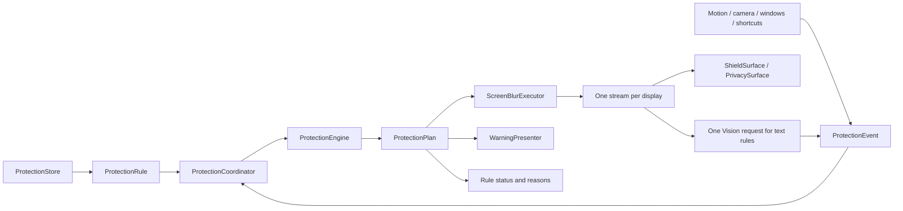

# Rule architecture

## Target ownership

ProtectionRule is the persisted product definition: trigger, scope, action, guards,
enabled state, priority, stable identity, and creation time. Runtime sensor decisions
and manual activations are transient engine state, not additional persisted feature
switches. Presentation and calibration infrastructure live in ProtectionPreferences.

ProtectionEngine is a deterministic value type in ShieldCore. ProtectionEvent is
the single input vocabulary. Each evaluation produces ProtectionPlan, containing
per-display coverage, direction, regions, text regions, focus exclusions, blur
parameters, active rule identities/reasons, warnings, and permitted OCR/capture demand.
The engine never captures, renders, saves, plays sound, or schedules a timer.

ProtectionCoordinator is the main-actor application boundary. It validates and
registers changed shortcuts before committing edits, batches input events into a single executor
submission, manages global commands and warning deadlines, and delegates warning
presentation to WarningPresenter. ShortcutRegistry describes manual activation
and hold-to-peek bindings and detects conflicts by key/modifier codes.

Escape is borrowed after applying input events and before submitting their final
plan. Dormant manual rules do not reserve Escape, and peek bindings are registered
only while their manual rule is active. Stable Carbon IDs keep key-release events
associated with their rule across edits. A failed registration rejects an edit
before persistence; a failed store commit restores previous bindings.

ScreenBlurExecutor consumes plans and is the only screen capture owner. Each display
has one DisplayCapture shared by full-screen blur, local regions, and all OCR rules.
ScreenBlurRenderPlan carries the full-screen radius and ordered display-relative
regional crops. Core Image evaluates Gaussian blur on the original input only for
those crops and composites one regional image; full-screen output remains separate.
This preserves per-rule radii and overlap priority without rendering one full display
for every radius. Region-only frames reuse the composite for readiness. Opaque dark
pixels outside its crops prevent new masks from revealing unprotected stale pixels.

All OCR rules share the same raw sample and one LocalTextAnalyzer Vision request.
Only per-rule geometry reaches the event bus. Permission/paused/cleared state controls
capture and analysis demand. Nearby blur monitoring requests prewarmed captures.
Startup waits for previous start/stop generations; normal plan changes reuse streams
and content metadata. Failures require explicit retry, and generation/identity checks
reject callbacks from stopped streams.

ScreenCaptureAdapter is the live ScreenCaptureKit factory behind an injectable
ScreenFrameCapturing interface. Pipeline tests exercise the actual executor and
its surfaces with simulated stream lifecycle events and small synthetic pixels;
they do not capture the user's desktop.

## Conflict and lifecycle rules

Global pause/suspend/clear precede normal output. Full-screen/display rules precede
focus and local regions. Within each class, higher numeric priority wins, then
earlier creation time, then UUID for a deterministic final tie. Coverage takes
the maximum; local geometry contributes a union. Focus carves the active window
out of full-screen output and suspends head-turn rules. A held peek removes only
the corresponding sustained manual blur contribution.

Owner verification gates uncovering rather than covering: missing verification
continues extra-face protection. Warning escalation is sticky until the trigger
resolves or protection is explicitly cleared; increasing a deadline cannot uncover
an already covered screen. Blur now upgrades the original warning rule/scope.

The legacy per-app pause only suspended head blur. The action therefore supports
`pauseOtherProtection(duration:target:)`, with a default target of `all` and an
explicit `headTurn` target for migrated app preferences. This preserves the legal
appEvent action while avoiding accidental loss of manual/OCR/nearby protection.

Escape suppresses camera/OCR/app/saved-area activations until explicit resume.
AirPods rearm after a clear centered sample, preserving the original behavior.
AppModel stops camera monitoring on Escape; application integration tests prove
that lifecycle behavior in addition to the pure engine tests.

## Current integration state

AppModel now assembles the rule path by default. RuleEventSources
feeds application/window geometry, selection and configuration edits into the
coordinator. NearbyPeople supplies detection/monitoring events without its legacy
warning/coverage evaluator in this path. Motion, OCR, manual shortcuts, preview,
demonstration, pause, resume, Escape, and warning upgrades all submit plans.

PrivacyController now contains window/area selection and computed projections of
rules/plans. Its former flags, preferences, capture streams, OCR workers, and renderer
are removed. ShieldOverlay's controller is deleted; ShieldSurface remains a rendering
adapter used by ScreenBlurExecutor. The application no longer accepts a legacy-mode
flag. A migration load failure keeps the original preferences unchanged, displays an
error, and starts no protection sensors; an integration test verifies this state.

The workspace has exactly Protection, Rules, and Settings, presets, a constrained
editor, and calibration tools. Old feature settings pages and the profile popover
are removed. Notch and status menus activate manual rules or global commands. Home
and notch list active names, IDs, and reasons. Update preferences use the rule document.

Multiple nearby detection modes share a single camera sample and one event batch.
Each mode has separate presence/attention/owner-verification policy state. Camera
head rules use independent instances of the existing CameraHeadPolicy with their
own angles, while AirPods rules keep separate ShieldResponse/DisplayHeadTracking
instances. The engine associates coverage/calibration samples with rule IDs, so one
rule cannot supply another rule's coverage or calibration. Camera and AirPods rules
can coexist; camera lifecycle remains independent of the calibration UI source.

Native UI tests read rendered text and use mouse events to navigate/save a validated
rule. Regional pipeline/mask tests verify exact radii from one captured frame, no
restart on edits, and deterministic overlap ownership. README and offline Help
now describe the three-page workflow, modifiers, global commands, and migration.

NearbyPeople now has no standalone warning evaluator, pause timer, or legacy preference
reader/writer. NearbyRuleAdapter connects camera events, rule configuration, template
availability and commands to the coordinator. OwnerRecognition handles authenticated
Keychain access and enrollment; rule guards determine verification requirements.
Enrollment/deletion preserve guards and deleting a template immediately invalidates
verification. The old feature shortcut registry/recorder and global head response
have also been removed. Global commands, including the Pause AppIntent, use the engine.

Remembered manual regions restore through the engine when a matching title-digest
window appears. Manual clear stays cleared during repeated geometry updates; Escape
requires explicit resume. Session window IDs/PIDs are removed from remembered scopes.
Selection workflows pass the requested recipe ID and preserve unrelated window rules.
Default appearance changes do not overwrite custom app-conditioned blur parameters.

The final acceptance audit is in parity-matrix.md. Resume, wake and visible pause
expiry prepend fresh geometry, permissions and sensor context before publishing
one final plan. Timer expiry and global commands received during suspension update
the queued user state without releasing lifecycle suspension. Camera rules that
were calibrated retain protective coverage across permission loss and recalibration;
resumed motion waits for a fresh sample and rejects callbacks from old generations.
Escape is processed last within an event batch.

## Verification

ProtectionRuleTests checks all 168 trigger × scope × action combinations plus
peek, owner, geometry, parameters, time guards, identity, and Codable behavior.
ProtectionEngineTests checks conflicts, unions, occlusion, focus, permissions,
Escape, pause/resume/sleep, warning actions, digest matching, owner fail-closed
behavior, and OCR demand. ProtectionCoordinatorTests checks commit-before-publish,
batched executor submissions, global lifecycle commands, and warning sound.
ShieldSurfaceTests checks the actual focus clip in full and directional masks;
LocalTextAnalyzerTests uses real Vision observations to check independent matches
from a single recognized image. RuleApplicationIntegrationTests exercises real
AppModel entrypoints using isolated preferences and injected sensors/execution.
ScreenCapturePipelineTests proves reuse, bounded lifecycle overlap, and explicit
failure recovery. RuleInterfaceTests additionally verifies rendered native UI navigation, rule saves,
and notch name/ID/reason text. Tests do not measure live camera accuracy or physical
AirPods calibration.

The final full debug regression passed 272 tests with zero skips/failures,
including the real preference copy, five native rendered UI/mouse tests, actual
Vision analysis, Keychain test fixtures, and processing measurements. The release
app/ZIP build and strict signature verification passed. For 100 rules across two
displays, evaluation averaged 0.432 ms. On a 1512×982 fixture, four exact-radius
crops took 4.174 ms versus 19.467 ms for four full-frame renders; 100 small regions
took 20.491 ms. Pixel tests compare cropped output with the original full-frame
renderer. These are bounded synthetic fixtures, not a claim about arbitrary
screen sizes or live sensor latency.

## Display-region selection

Manual and nearby-face rules additionally support
`displayRegion(id:normalizedRect:)`, added for screenshot-style selection in the
editor. The original window-region scope continues to follow its matching window.
Display regions use lower-left normalized coordinates and the display ID, and
produce ordinary ProtectionRegion entries in the one ProtectionPlan. Display
relocation/resizing therefore reprojects the crop; a disconnected display does not
redirect protection onto another screen. Permissions, Escape, warnings, priority,
control exclusions, and the shared capture executor still apply.

AreaSelectionController opens one transient selection overlay on each display.
The editor-only Carbon shortcut lease borrows the configured area chord or
registers an available fallback, showing the actual chord beside Select region.
It routes selection into the draft, then restores the original shortcut dispatch
when the scope stage/editor closes. No rule is installed until Save rule, and
selection does not capture or persist any screen pixels.

## Presentation polish

The workspace, editor and notch panels share the original restrained dark palette
with a soft pink accent. Primary actions are distinct from secondary controls.
Preset and quick-action cards describe their effect; rule rows emphasize name,
range and response. Rule IDs remain available in expandable details. Application
IDs and numeric window-region coordinates are accessible in advanced matching
and area adjustment sections. Editor steps read When / Where / Response, with
English and Simplified Chinese copy.

This pass changes presentation only: the core types, evaluator, store, coordinator,
AppModel, event sources, shortcuts, capture/rendering and sensor algorithms remain
unchanged. Editor save, selection and application-picker handlers are unchanged.
